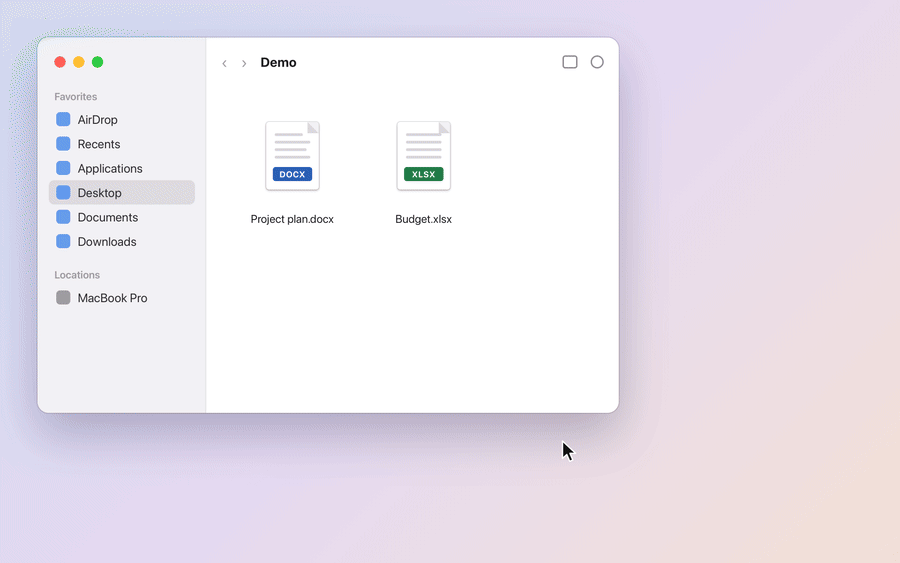

# Open in Google Docs — Quick Action для Finder на macOS

Правый клик по файлам Word, Excel, OpenDocument, RTF или CSV в Finder, и через несколько секунд они открываются в браузере **настоящими Google Документами и Таблицами**. Не нужны ни Google Drive для компьютера, ни папка синхронизации, ни перетаскивание файлов во вкладку браузера.



[English version](README.md)

## Что умеет

| Quick Action | Файлы | Во что превращаются |
|---|---|---|
| **↗ В Google Docs** | `.docx` `.doc` `.odt` `.rtf` | Google Документы |
| **↗ В Google Таблицы** | `.xlsx` `.xlsm` `.xls` `.ods` `.csv` `.tsv` | Google Таблицы |

- Один запрос к Google Drive API на файл: загрузка и конвертация сразу, примерно 3–5 секунд на файл. До 8 файлов одновременно.
- Сконвертированные файлы складываются в папку **Из Mac** на твоём Drive.
- Уведомления на языке macOS (русский, украинский, английский) и по делу: файл под паролем или повреждён, нет интернета, кончилось место, Google не ответил.
- Если Google замолчал посреди загрузки, утилита проверяет, не создался ли файл. Если создался, открывает его, если нет, загружает ещё раз.
- Ничего не надо ставить через pip: только стандартная библиотека Python и системный `/usr/bin/python3`.

## Приватность

- Файлы идут напрямую с твоего Mac на твой Google Drive. Посредников и телеметрии нет.
- Утилита работает с доступом `drive.file` и видит только файлы, которые создала сама, а не весь Drive.
- OAuth-ключи остаются в конфиге rclone (`~/.config/rclone/rclone.conf`). Токен доступа кэшируется на час в `~/Library/Caches/to_gdocs/token.json`, читать его можешь только ты.

## Что нужно

- macOS 12 Monterey или новее.
- Xcode Command Line Tools, они дают `/usr/bin/python3`: `xcode-select --install`.
- [rclone](https://rclone.org), он нужен только для входа в Google: `brew install rclone`.
- Аккаунт Google и свой бесплатный OAuth-клиент в Google Cloud (шаг 1 ниже).

## Настройка

### 1. Создай свой OAuth-клиент Google (один раз, минут 5)

Google хочет, чтобы у каждого приложения был свой OAuth-клиент, а общий клиент rclone закрывают, поэтому создай свой:

1. Открой [Google Cloud Console](https://console.cloud.google.com/) и создай проект с любым именем.
2. **APIs & Services → Library**: найди **Google Drive API** и нажми **Enable**.
3. **Google Auth Platform** (раньше *OAuth consent screen*): **Get started**, имя приложения (например, «Open in Google Docs»), свой email, тип **External**.
4. **Audience → Publish app**, чтобы статус стал **In production**. Без этого Google будет разлогинивать тебя каждые 7 дней. Доступ `drive.file` не относится к чувствительным, поэтому проверка приложения Google не нужна.
5. **Clients → Create client → Desktop app**. Скопируй **Client ID** и **Client secret**.

### 2. Подключи rclone к Drive

```sh
rclone config create gdrive drive client_id=ТВОЙ_CLIENT_ID client_secret=ТВОЙ_CLIENT_SECRET scope=drive.file
```

Откроется браузер: войди в аккаунт и нажми **Разрешить**. Если Google напишет, что приложение не проверено, выбери **Дополнительно → Перейти к …**: это твоё собственное приложение.

### 3. Установи Quick Actions

Скачай или склонируй репозиторий, открой Терминал в его папке и запусти:

```sh
./install.sh
```

Скрипт скопирует оба Quick Action в `~/Library/Services` и пропишет в них путь к этой папке. Если перенесёшь папку, запусти его ещё раз.

### 4. Пользуйся

Выдели файлы в Finder → правый клик → **Быстрые действия** → **↗ В Google Docs** или **↗ В Google Таблицы**.

Если пунктов нет, открой правый клик → **Быстрые действия → Настроить…** и включи их. Ещё их можно найти в разделе **Службы** того же меню.

## Важно знать

- **CSV и TSV Google читает по американским правилам.** Числа с запятой (`1,5`) и даты вида `21.10.2026` остаются текстом, а у кодов из одних цифр пропадают ведущие нули. Разделители и кодировки (`;`, табуляцию, Windows-1251) Google определяет сам. Когда важны точные значения, используй `.xlsx`.
- **Документы и таблицы отправляй по отдельности.** macOS показывает Quick Action, только если ему подходят все выделенные файлы.
- **Файлы под паролем** Google не конвертирует. Сначала сними пароль.
- **Действуют лимиты Google на импорт**, например 100 МБ для таблиц.
- **Файлы Numbers и Pages** не поддерживаются, потому что Google их не импортирует. Сначала экспортируй их в Excel или Word.
- В редком случае Google доделывает зависшую загрузку уже после начала повтора, и тогда файл появляется в двух копиях.

## Если что-то не так

Каждый запуск пишется в `~/Library/Logs/to_gdocs.log`, вместе с причиной ошибки от самого Google.

| Уведомление | Что делать |
|---|---|
| Google Drive ещё не настроен | Сделай шаги 1–2. Подключение rclone должно называться `gdrive` и использовать твой client ID. Утилита читает `~/.config/rclone/rclone.conf` (или старый `~/.rclone.conf`; проверь командой `rclone config file`) и не умеет читать конфиг rclone, зашифрованный паролем. |
| rclone не установлен | `brew install rclone` |
| Нужно заново войти в Google | Откроется страница входа: нажми **Разрешить** и запусти Quick Action ещё раз. Если так каждую неделю, опубликуй приложение (шаг 1.4). |
| Google не смог открыть файл | Скорее всего, файл под паролем. |
| Google не смог прочитать файл | Файл пустой или повреждён. |
| Google не ответил | Попробуй ещё раз. Один повтор утилита уже сделала сама. |

## Настройки

Константы в начале `to_gdocs.py`:

- `REMOTE`: имя подключения rclone.
- `FOLDER_NAME`: папка на Drive. По умолчанию «Из Mac» на языке системы.
- `STALL_TIMEOUT`: сколько Google может молчать, прежде чем утилита проверит и повторит загрузку.

## Удаление

```sh
./uninstall.sh
```

Удаляет Quick Actions и кэш токена. Подключение rclone, лог и твои файлы на Google Drive остаются.

## Как устроено

`to_gdocs.sh` запускает `/usr/bin/python3 -I to_gdocs.py` с выделенными файлами. Для каждого файла скрипт:

1. Берёт токен доступа из кэша или получает новый по refresh-токену из подключения rclone.
2. Отправляет одну multipart-загрузку с целевым типом Google в метаданных, и Drive конвертирует файл прямо при загрузке.
3. Открывает ссылку на новый документ в браузере по умолчанию.

У каждой загрузки есть случайная метка в `appProperties`. Если Google не ответил вовремя, по этой метке утилита находит файл, который он всё-таки создал, и не загружает его второй раз.

## Разработка

```sh
/usr/bin/python3 -m unittest discover -s tests -v
```

Офлайн-тесты на поддельном сервере Drive. Аккаунт Google для них не нужен.

## Лицензия

[MIT](LICENSE)
